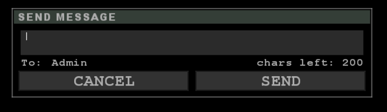

# ETJump admin system
ETJump includes a simple admin system, with configurable levels and built-in authentication system. `etkey` is completely ignored by the mod, and client identities are tied to the GUID found in `etjump/etguid.dat` instead. This file is automatically generated when connecting to a server, if it doesn't already exist.

```{important}
Keep this file safe! Never share it with others, and make sure it's backed up in case you lose it.
```

```{note}
The GUID displayed as part of [`!userinfo`](admin_system.md/#userinfo) and in the client's userinfo string is a SHA-1 hashed version of your actual GUID stored in `etguid.dat`. It is not dangerous if other players see this - it cannot be used to determine your real GUID in order to impersonate you.
```

Admins can configure the levels and their commands, as well as some other additional parameters, using the [`levels config file`](server_cvars.md/#g_levelconfig). A sample configuration file will be automatically generated by the mod when starting a server, if one isn't yet present.

User data is stored in the [`user database`](server_cvars.md/#g_userconfig). The server generates a unique ETJump ID for each new player that visits the server, and stores it in this database. It also contains any bans issued on the server, and any custom, client-specific configurations, such as greeting and title.

## Permission system

Access to admin commands is controlled by flags. The table below lists all available command flags, and the commands that they offer.

```{note}
The flags are case sensitive.
```

Flag | Commands
:----|:--------------------
\*   | all commands
/    | [`silent command execution`](admin_system.md/#silent-command-execution)
a    | [`8ball`](admin_system.md/#8ball) [`admintest`](admin_system.md/#admintest) [`best-segments`](admin_system.md/#best-segments) [`best-segments-history`](admin_system.md/#best-segments-history) [`findmap`](admin_system.md/#findmap) [`help`](admin_system.md/#help) [`leastplayed`](admin_system.md/#leastplayed) [`list-removed-records`](admin_system.md/#list-removed-records) [`list-removed-segments`](admin_system.md/#list-removed-segments) [`listmaps`](admin_system.md/#listmaps) [`loadcheckpoints`](admin_system.md/#loadcheckpoints) [`mapinfo`](admin_system.md/#mapinfo) [`mostplayed`](admin_system.md/#mostplayed) [`newmaps`](admin_system.md/#newmaps) [`rankings`](admin_system.md/#rankings) [`record-history`](admin_system.md/#record-history) [`ranks, records, times and top`](admin_system.md/#ranks-records-times-and-top) [`remove-record`](admin_system.md/#remove-record) [`remove-segment`](admin_system.md/#remove-segment) [`restore-record`](admin_system.md/#restore-record) [`restore-segment`](admin_system.md/#restore-segment) [`rtv`](admin_system.md/#rtv) [`seasons`](admin_system.md/#seasons) [`spectate`](admin_system.md/#spectate)
A    | [`addlevel`](admin_system.md/#addlevel) [`deletelevel`](admin_system.md/#deletelevel) [`editcommands`](admin_system.md/#editcommands) [`editlevel`](admin_system.md/#editlevel) [`edituser`](admin_system.md/#edituser) [`finduser`](admin_system.md/#finduser) [`levelinfo`](admin_system.md/#levelinfo) [`listusernames`](admin_system.md/#listusernames) [`listflags`](admin_system.md/#listflags) [`listusers`](admin_system.md/#listusers) [`userinfo`](admin_system.md/#userinfo)
b    | [`ban`](admin_system.md/#ban) [`unban`](admin_system.md/#unban) 
c    | [`add-customvote`](admin_system.md/#add-customvote) [`delete-customvote`](admin_system.md/#delete-customvote) [`edit-customvote`](admin_system.md/#edit-customvote)
C    | [`cancelvote`](admin_system.md/#cancelvote)
f    | [`finger`](admin_system.md/#finger)
k    | [`kick`](admin_system.md/#kick)
l    | [`listplayers`](admin_system.md/#listplayers)
L    | [`listbans`](admin_system.md/#listbans)
m    | [`mute`](admin_system.md/#mute) [`unmute`](admin_system.md/#unmute)
M    | [`map`](admin_system.md/#map)
N    | [`noclip`](admin_system.md/#noclip)
P    | [`passvote`](admin_system.md/#passvote)
r    | [`restart`](admin_system.md/#restart)
R    | [`rename`](admin_system.md/#rename)
s    | [`setlevel`](admin_system.md/#setlevel)
S    | [`access to adminchat`](admin_system.md/#admin-chat)
T    | [`add-season`](admin_system.md/#add-season) [`delete-season`](admin_system.md/#delete-season) [`edit-season`](admin_system.md/#edit-season)
v    | [`moverscale`](admin_system.md/#moverscale)
V    | [`tokens`](admin_system.md/#tokens)

---

## Admin chat

Any player with the `S` command flag has access to admin chat. This is a chat system which is isolated from the rest of the chat on the server. Anyone with the flag `S` can both see and send messages to the chat.

Players can send messages to admin chat via the chat window by selecting "Admin" as the destination. If the player does not have permissions to send messages to admin chat, the message is simply dropped entirely.

Admin chats are excluded from standard log files - they are logged into the [admin log](#admin-system-logging).



```{tip}
Messages to admin chat can also be sent from console with the following commands

* [`enc_say_admin`](../client/client_commands.md/#enc_say-enc_say_team-enc_say_buddy-enc_say_admin)
* [`ma`, `say_admin`](../client/client_commands.md/#ma-say_admin)
```

```{tip}
Similar to team and fireteam chats, it's possible to create a bind that opens the chat window with "Admin" selected as destination, using the [`adminChat`](../client/client_commands.md/#adminchat) command. This isn't bound to anything by default.

`bind <key> adminChat`
```

An admin chat is colored orange, and prefixed with a `>`.


If desired, admin chat can be disabled on the server with the [`g_adminChat`](server_cvars.md/#g_adminchat) cvar.

---

## Admin system logging

By default, servers log certain admin-related events to a log file specified in [`g_adminLog`](server_cvars.md/#g_adminlog) cvar (unless [`g_dailyLogs`](server_cvars.md/#g_dailylogs) is enabled, in which case a new log file will be created daily). When enabled, the following events are logged:

* Admin chat
* Usage of admin commands with flags `b`, `C`, `A`, `k`, `m`, `P`, `R`, `s`, `T` and `c`
* Authentication related events (potential GUID/HWID spoofs, rejected connections)

---

## List of admin commands

Below you'll find a list of all the admin commands, with explanations on what they do and what flag is required to access them.

```{note}
The admin system was written a long time ago, and some of the more advanced functionality is not very well implemented. The admin system will be rewritten in the future to be more robust and better to use.
```

```{tip}
Admin commands support "auto-complete", so you don't have to type in the full name of each command. For example, `!admin` will execute `!admintest`. If you're not writing the full command, you must provide enough characters from the command that it can resolve to a single command available for your level.
```

---

### 8ball
8ball answers all your questions with three possible answers: yes, no and maybe.

`!8ball <question>`

**Flag:** a

{.option-table}
Option                    | Description
:-------------------------|:------------
**question**              | The question to ask.

---

### add-customvote
Adds a new custom map vote list.

`!add-customvote -n <name> -fn <callvote_text> -m <map1 map2 map3 ...>`

**Flag:** c

{.option-table}
Option                    | Description
:-------------------------|:------------
**-n, --name**            | Name of the custom map vote list.
**-fn, --full-name**      | Full name of the list, displayed on the callvote.
**-m, --maps**            | Space separated list of maps to include in the list.

```{note}
This command does not perform any validation on the list of maps provided, it is up to the user to provide valid map names.
```

---

### add-season
Adds a new timerun season.

`!add-season -n <name> -sd <YYYY-MM-DD> [-ed <YYYY-MM-DD>]`

**Flag:** T

{.option-table}
Option                    | Description
:-------------------------|:------------
**-n, --name**            | Name of the season.
**-sd, --start-date**     | Start date of the season (`YYYY-MM-DD`).
-ed, --end-date-exclusive | Exclusive end date of the season (`YYYY-MM-DD`). If not set, the season stays active until an end date is added with [`!edit-season`](admin_system.md/#edit-season), or the season is deleted with [`delete-season`](admin_system.md/#delete-season).

```{note}
Season names are case insensitive.
```

---

### addlevel
Adds a new level.

`!addlevel <level> [-cmds <commands>] [-greeting <greeting>] [-title <title>]`

**Flag:** A

{.option-table}
Option                    | Description
:-------------------------|:------------
**level**                 | The level to add.
-cmds                     | Commands for the level.
-greeting                 | Greeting for the level.
-title                    | Title for the level.

---

### admintest
Prints your admin level to everyone in the chat.

**Flag:** a

---

### ban
Bans a player.

`!ban <name|clientnum> [time (seconds)] [reason]`

**Flag:** b

{.option-table}
Option                    | Description
:-------------------------|:------------
**name\|clientnum**       | The name or clientnum of the player to ban.
time                      | Ban duration in seconds. If not given, the ban is permanent. Value **0** also means permanent.
reason                    | Reason for the ban, printed to the banned user. Requires `time` to be given.

```{note}
Temporary bans do not currently expire during a map. If a ban timeout has expired during current map on the server, the map must be changed for the banned client to be able to connect.
```

---

### best-segments
See the [`best-segments`](../client/client_commands.md/#best-segments) client command for usage.

**Flag:** a

---

### best-segments-history
See the [`best-segments-history`](../client/client_commands.md/#best-segments-history) client command for usage.

**Flag:** a

---

### cancelvote
Cancels currently active vote.

**Flag:** C

---

### comparecheckpoints
See the [`comparecheckpoints`](../client/client_commands.md/#comparecheckpoints) client command for usage.

**Flag:** a

---

### delete-customvote
Deletes a custom map vote list.

`!delete-customvote -n <name>`

**Flag:** c

{.option-table}
Option                    | Description
:-------------------------|:------------
**-n, --name**            | Name of the list to delete. Must be an exact match.

---

### delete-season
Deletes a timerun season.

`!delete-season -n <name>`

**Flag:** T

{.option-table}
Option                    | Description
:-------------------------|:------------
**-n, --name**            | Name of the season to delete. Must be an exact match.

```{caution}
This will delete all timerun records associated with the season!
```

```{note}
Season names are case insensitive.
```

---

### deletelevel
Deletes a level.

`!deletelevel <level>`

**Flag:** A

{.option-table}
Option                    | Description
:-------------------------|:------------
**level**                 | The level to delete.

```{note}
Users who are currently set to deleted level will be set to level 0.
```

---

### edit-customvote
Edits an existing custom map vote list.

`!edit-customvote -l <list> [-n <name>] [-fn <callvote_text>] [-am <maps>] [-rm <maps>]`

**Flag:** c

{.option-table}
Option                    | Description
:-------------------------|:------------
**-l, --list**            | Name of the list to edit.
-n, --name                | New name for the list.
-fn, --full-name          | New full name of the list, displayed on the callvote.
-am, --add-maps           | Space separated list of maps to add to the list.
-rm, --remove-maps        | Space separated list of maps to remove from the list.

---

### edit-season
Edits an existing timerun season.

`!edit-season -n <name> [-sd <YYYY-MM-DD>] [-ed <YYYY-MM-DD>]`

**Flag:** T

{.option-table}
Option                    | Description
:-------------------------|:------------
**-n, --name**            | Name of the season to edit.
-sd, --start-date         | New start date for the season (`YYYY-MM-DD`).
-ed, --end-date           | New end date for the season (`YYYY-MM-DD`).

```{note}
Season names are case insensitive.
```

---

### editcommands
Edits commands for a level.

`!editcommands <level> [+command] [-command]`

**Flag:** A

{.option-table}
Option                    | Description
:-------------------------|:------------
**level**                 | The level to edit.
+command                  | Adds the command to the level.
-command                  | Removes the command from the level.

This does **not** use command flags, but rather explicit command names.

The following example adds kick and ban to level 5 and removes 8ball from the level 5

`!editcommands 5 +kick +ban -8ball`

```{todo}
Verify that this actually works as it should. It interacts weirdly with the `Commands` field in the level config.
```

---

### editlevel
Edits a level with given arguments.

`!editlevel <level> [-cmds <flags>] [-greeting <greeting>] [-title <title>] [-clear <cmds|greeting|title>]`

**Flag:** A

{.option-table}
Option                    | Description
:-------------------------|:------------
**level**                 | The level to edit.
-cmds                     | Command flags for the level.
-greeting                 | Greeting for the level.
-title                    | Title for the level.
-clear                    | Clears the given field(s). Accepts `cmds`, `greeting` or `title`.

---

### edituser
Edits a user.

`!edituser <user ID> [-cmds <flags>] [-greeting <greeting>] [-title <title>] [-clear <cmds|greeting|title>]`

**Flag:** A

{.option-table}
Option                    | Description
:-------------------------|:------------
**user ID**               | The user ID of the user to edit.
-cmds                     | Command flags for the user.
-greeting                 | Greeting for the user.
-title                    | Title for the user.
-clear                    | Clears the given field(s). Accepts `cmds`, `greeting` or `title`.

These permissions and parameters override the regular permissions and parameters that the users' level provides.

```{tip}
This works even if the user is not connected to the server
```

---

### findmap
Lists all maps on server matching `<mapname>`.

`!findmap <mapname> [maps per row (1-5)]`

**Flag:** a

{.option-table}
Option                    | Description
:-------------------------|:------------
**mapname**               | Map name to search for.
maps per row              | Number of maps to print per row (1-5). Defaults to **3**.

---

### finduser
Lists users that match the name.

`!finduser <name>`

**Flag:** A

{.option-table}
Option                    | Description
:-------------------------|:------------
**name**                  | The name to search for.

---

### finger
Prints name, original name, user ID, level and title of the targeted player.

`!finger <name|clientnum>`

**Flag:** f

{.option-table}
Option                    | Description
:-------------------------|:------------
**name\|clientnum**       | The targeted player.

---

### help
Prints all available admin commands. If `[command]` is given, prints the manual for the given command.

`!help [command]`

**Flag:** a

{.option-table}
Option                    | Description
:-------------------------|:------------
command                   | The command to print the manual for.

---

### kick
Kicks target player.

`!kick <name|clientnum> [timeout (seconds)] [reason]`

**Flag:** k

{.option-table}
Option                    | Description
:-------------------------|:------------
**name\|clientnum**       | The player to kick.
timeout                   | Duration in seconds during which the kicked player is unable to connect to the server.
reason                    | Reason for the kick, shown to the kicked player.

---

### leastplayed
Lists the least played maps on the server.

`!leastplayed [count (1-100)]`

**Flag:** a

{.option-table}
Option                    | Description
:-------------------------|:------------
count                     | Number of maps to list (1-100). Defaults to **10**.

---

### levelinfo
Lists all levels configured on the server, or information about a specific level.

`!levelinfo [level]`

**Flag:** A

{.option-table}
Option                    | Description
:-------------------------|:------------
level                     | If given, prints detailed information about the given level.

---

### listbans
Lists all active bans on the server.

`!listbans [page]`

**Flag:** L

{.option-table}
Option                    | Description
:-------------------------|:------------
page                      | Page to display. A single page fits **10** bans.

```{error}
The ban IDs may be incorrect if a player was banned or unbanned during the current map. Changing the map will sync the IDs correctly.
```

---

### listcheckpoints
See the [`listcheckpoints`](../client/client_commands.md/#listcheckpoints) client command for usage.

**Flag:** a

---

### listflags
Lists command flags for each admin command.

**Flag:** A

---

### listmaps
Lists all maps on the server.

`!listmaps [maps per row (1-5)]`

**Flag:** a

{.option-table}
Option                    | Description
:-------------------------|:------------
maps per row              | Number of maps to print per row (1-5). Defaults to **5**.

---

### listplayers
Lists all players connected to the server, including their clientnum, user ID, level and name.

**Flag:** l

---

### listusernames
Lists all usernames registered for the given `<user ID>` on the server.

`!listusernames <user ID>`

**Flag:** A

{.option-table}
Option                    | Description
:-------------------------|:------------
**user ID**               | The user ID to list usernames for.

```{error}
The user database currently fails to record a name for a user, if the name they have has already been saved and used by another user.
```

---

### listusers
Lists users that are registered on the server's user database.

`!listusers [page]`

**Flag:** A

{.option-table}
Option                    | Description
:-------------------------|:------------
page                      | Page to display. A single page fits **20** users.

---

### list-removed-records
See the [`list-removed-records`](../client/client_commands.md/#list-removed-records) client command for usage.

**Flag:** a

---

### list-removed-segments
See the [`list-removed-segments`](../client/client_commands.md/#list-removed-segments) client command for usage.

**Flag:** a

---

### loadcheckpoints
See the [`loadcheckpoints`](../client/client_commands.md/#loadcheckpoints) client command for usage.

**Flag:** a

---

### map
Changes to the specified map.

`!map <map name>`

**Flag:** M

{.option-table}
Option                    | Description
:-------------------------|:------------
**map name**              | The map to change to. Must be an full match (case insensitive)

---

### mapinfo
Prints information about a map.

`!mapinfo [map]`

**Flag:** a

{.option-table}
Option                    | Description
:-------------------------|:------------
map                       | Map to print information about. Default is the current map.

---

### mostplayed
Lists the most played maps on the server.

`!mostplayed [count (1-100)]`

**Flag:** a

{.option-table}
Option                    | Description
:-------------------------|:------------
count                     | Number of maps to list (1-100). Defaults to **10**.

---

### moverscale
Scales movement speed of entities following spline paths (typically vehicles) by the given value.

`!moverscale <value (0.1-5.0)>`

**Flag:** v

{.option-table}
Option                    | Description
:-------------------------|:------------
**value**                 | Movement speed scale (0.1-5.0).

```{seealso}
[`g_moverScale`](server_cvars.md/#g_moverscale)
```

---

### mute
Mutes the targeted player.

`!mute <name|clientnum>`

**Flag:** m

{.option-table}
Option                    | Description
:-------------------------|:------------
**name\|clientnum**       | The name or clientnum of the player to mute.

---

### newmaps
Displays the latest maps added to the server, sorted from oldest to newest.

`!newmaps [count (1-50)]`

**Flag:** a

{.option-table}
Option                    | Description
:-------------------------|:------------
count                     | Number of maps to list (1-50). Defaults to **5**.

```{note}
If a map has been on the server previously but later removed, it has already been registered to the servers map database and won't be displayed as the newest map if re-added.
```

---

### noclip
Enables `noclip`.

`!noclip [name|clientnum] [count]`

**Flag:** N

{.option-table}
Option                    | Description
:-------------------------|:------------
name\|clientnum           | If given, the targeted player can use `noclip` once.
count                     | Number of times the targeted player can use `noclip`. Value **-1** allows unlimited use until the targeted player disconnects.

```{note}
This command has no effect if [`g_noclip`](server_cvars.md/#g_noclip) is set to **1**.
```

---

### passvote
Forces currently active vote to pass.

**Flag:** P

```{note}
Rock the Vote cannot be passed using this command.
```

---

### rankings
See the [`rankings`](../client/client_commands.md/#rankings) client command for usage.

**Flag:** a

---

### ranks, records, times and top
See the [`ranks, records, times, top`](../client/client_commands.md/#ranks-records-times-top) client command for usage.

**Flag:** a

---

### record-history
See the [`record-history`](../client/client_commands.md/#record-history) client command for usage.

**Flag:** a

---

### remove-record
See the [`remove-record`](../client/client_commands.md/#remove-record) client command for usage.

**Flag:** a

---

### remove-segment
See the [`remove-segment`](../client/client_commands.md/#remove-segment) client command for usage.

**Flag:** a

---

### rename
Renames the targeted player.

`!rename <name|clientnum> <new name>`

**Flag:** R

{.option-table}
Option                    | Description
:-------------------------|:------------
**name\|clientnum**       | The name or clientnum of the player to rename.
**new name**              | The new name for the player.

```{note}
This does not decrease the name change limit defined by [`g_nameChangeLimit`](server_cvars.md/#g_namechangelimit), unless you're targeting yourself.
```

---

### restart
Restarts the current map.

**Flag:** r

---

### restore-record
See the [`restore-record`](../client/client_commands.md/#restore-record) client command for usage.

**Flag:** a

---

### restore-segment
See the [`restore-segment`](../client/client_commands.md/#restore-segment) client command for usage.

**Flag:** a

---

### rtv
Calls Rock the Vote.

`!rtv [list]`

**Flag:** a

{.option-table}
Option                    | Description
:-------------------------|:------------
list                      | If given, limits the maps to the ones included in the specified custom map vote list.

---

### seasons
Lists all timerun seasons on the server.

**Flag:** a

---

### setlevel
Sets adminlevel of the targeted player.

`!setlevel <name|clientnum> <level>`  
`!setlevel -id <user ID> <level>`

**Flag:** s

{.option-table}
Option                    | Description
:-------------------------|:------------
**name\|clientnum\|-id**  | The player to set the level for.
**level**                 | The level to set.

```{tip}
When using `-id <user ID>`, the targeted player does not have to be connected to the server.
```

---

### spectate
Switches your team to spectators.

`!spectate [name|clientnum]`

**Flag:** a

{.option-table}
Option                    | Description
:-------------------------|:------------
name\|clientnum           | If given, starts following the given player.

---

### tokens
Creates, deletes or moves a collectible token with given arguments.

`!tokens create <easy|e|medium|m|hard|h>`  
`!tokens delete [easy|e|medium|m|hard|h <number (1-32)>]`  
`!tokens move`

**Flag:** V

{.option-table}
Option                    | Description
:-------------------------|:------------
create                    | Creates a token at your location with the given difficulty.
delete                    | Deletes the token closest to your location, or a specific token from the given difficulty.
move                      | Moves the token closest to you to your current location.

```{note}
[`g_tokensMode`](server_cvars.md/#g_tokensmode) must be set to **1** for these commands to work.
```

---

### unban
Removes a ban with the given `<ban id>`.

`!unban <ban id>`

**Flag:** b

{.option-table}
Option                    | Description
:-------------------------|:------------
**ban id**                | The ID of the ban to remove.

```{note}
The unbanned player won't be able to connect to the server until the next time the map is changed.
```

---

### unmute
Unmutes the targeted player.

`!unmute <name|clientnum>`

**Flag:** m

{.option-table}
Option                    | Description
:-------------------------|:------------
**name\|clientnum**       | The player to unmute.

---

### userinfo
Prints information about the given user.

`!userinfo <user ID>`

**Flag:** A

{.option-table}
Option                    | Description
:-------------------------|:------------
**user ID**               | The user ID of the user to print information about.

---

### Silent command execution
Allows clients to execute any admin commands available to them silently, without having the typed command appear in chat.

`/!command`

**Flag:** /

```{note}
Silent commands must be typed in console instead of chat. Any output that a command might produce for other players will still be visible.
```
